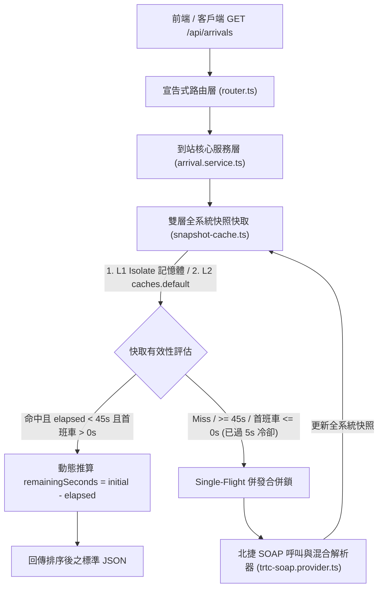

# Railway-Project-TRTC

**台北捷運（TRTC）即時到站 API 中繼代理、區間車同向合併與動態倒數快取服務**（建構於 **Cloudflare Workers + TypeScript**，零外部執行期相依套件）。

---

## 專案定位與解決問題

台北捷運官方 `TrackInfo` SOAP API 在實務串接上有幾項痛點：
1. **特殊的「JSON + XML 混合格式」**：回應主體前方直接輸出 JSON 陣列，後方緊接空的 SOAP Envelope XML，一般 REST 客戶端無法直接解析。
2. **區間車與全程車方向拆分**：上游僅提供列車終點站（`DestinationName`），未提供物理行駛方向，導致往同方向的區間車（如往北投、大安、亞東醫院、昆陽、台電大樓）與全程車各自獨立，乘客難以一眼得知哪一班車先到。
3. **跨線終點站撞名**：上游無路線代碼欄位，而板南線（`BL`）與文湖線（`BR`）終點站同為「南港展覽館站」，在交會站「忠孝復興站」容易混淆。
4. **上游呼叫額度限制**：單次呼叫即回傳全系統約 320 筆列車狀態，若直接由前端輪詢或以單站為單位快取，極易耗盡 API 額度。

本專案部署於 Cloudflare Workers 邊緣節點，負責完成**混合格式清理、路線歸屬推斷、同向區間車合併排序、清客列車過濾，以及基於時間差的動態倒數快取推算**。

---

## 系統架構與快取流程



### 核心目錄結構

```text
Railway-Project-TRTC/
├── src/
│   ├── index.ts                      # Cloudflare Worker 進入點
│   ├── config/
│   │   ├── constants.ts              # 服務識別資訊與執行期預設參數
│   │   ├── trtc-network-v2.ts        # [v2] 依行駛方向分組之路網與各站可用方向設定
│   │   └── trtc-network.ts           # [v1 保留] 舊版路網與區間車 Flag 規則設定
│   ├── providers/
│   │   └── trtc-soap.provider.ts     # 北捷 SOAP 請求組裝與 JSON+XML 混合格式解析器
│   ├── cache/
│   │   └── snapshot-cache.ts         # L1 Isolate + Single-Flight + L2 Cache API 雙層快取管理
│   ├── services/
│   │   ├── arrival-v2.service.ts     # [v2] 方向導向到站查詢服務（無 Flag，與 v1 共用底層快取）
│   │   └── arrival.service.ts        # [v1 保留] 舊版到站查詢服務
│   ├── routes/
│   │   └── router.ts                 # 宣告式路由表（/, /health, /api/v2/*, /api/*）
│   ├── types/
│   │   ├── env.ts                    # Worker Env 與機密變數型別定義
│   │   ├── arrival-v2.ts             # [v2] 方向導向回應與路網型別定義
│   │   └── arrival.ts                # 共用快照型別、TrackDataProvider 介面與 v1 型別
│   └── utils/
│       ├── http.ts                   # 統一 JSON / CORS / AppError 回應工具
│       ├── station.ts                # 站名正規化（「台北車站」防呆）與倒數字串解析
│       └── xml.ts                    # SOAP XML 特殊字元跳脫工具
├── test/                             # Vitest 單元與整合測試（涵蓋 v1 與 v2）
├── .dev.vars.example                 # 本機環境變數範本（不含真實網址與憑證）
└── wrangler.jsonc                    # Cloudflare Workers 部署設定
```

---

## API 端點總覽

| 方法 | 路徑 | 版本 | 說明 |
| :--- | :--- | :---: | :--- |
| `GET` | `/` | 共用 | 服務身分資訊、支援路線摘要與所有可用端點導覽 |
| `GET` | `/health` | 共用 | 檢查服務狀態與上游憑證環境變數是否已配置（不暴露機密內容） |
| `GET` | `/api/v2/lines` | **v2 (推薦)** | 取得依「行駛方向」分組之路網設定與**每一站可選方向清單** |
| `GET` | `/api/v2/arrivals` | **v2 (推薦)** | 依路線、車站與行駛方向查詢即時到站倒數（無須 Flag，直接提供同向全數列車） |
| `GET` | `/api/lines` | v1 (舊版保留) | 舊版路網設定與區間車 Flag 規則（相容既有串接，未來可能下線） |
| `GET` | `/api/arrivals` | v1 (舊版保留) | 舊版指定終點站 + `includeShortTurn` 查詢端點 |

> **快取共享說明**：`v1` 與 `v2` 底層共用同一份 `SnapshotCacheManager` 全系統快照快取，兩版本混用不會增加上游北捷 API 呼叫次數。

---

## API v2 設計與方向規則（推薦使用）

`v2` 移除 `includeShortTurn` Flag，改以**實際月台行駛方向**為查詢單位，直接回傳該方向所有會進站的列車（由前端依每班車的 `destination` 呈現終點站名稱），並自動依所在車站區段過濾反方向列車與終點清客車：

| 路線代碼 | 路線名稱 | 支援方向 (`direction`) | 回傳列車終點 (`destination`) 規則 | 各站方向特殊規則 |
| :--- | :--- | :--- | :--- | :--- |
| `BR` | 文湖線 | `南港展覽館`、`動物園` | 依方向回傳往 `南港展覽館站` 或 `動物園站` | 於 `忠孝復興站` 自動與 `BL` 區分 |
| `R` | 淡水信義線 | `淡水`、`廣慈/奉天宮` | • **`淡水方向`**：回傳 `淡水站`、`北投站`、`新北投站`（於北投站）<br>• **`廣慈/奉天宮方向`**：回傳 `廣慈/奉天宮站`、`大安站`、`北投站`（於新北投站及北投以北回機廠班次） | `新北投站` 提供 `廣慈/奉天宮方向`（回傳折返北投列車） |
| `G` | 松山新店線 | `松山`、`新店`、`小碧潭`、`七張` | • **`新店方向`**：回傳 `新店站`、`台電大樓站`<br>• **`松山方向`**：僅 `松山站`<br>• **`小碧潭方向`**：`小碧潭站`<br>• **`七張方向`**：`七張站` | • `七張站` 提供 `松山`、`新店`、`小碧潭` 三方向<br>• `小碧潭站` 僅提供 `七張` 方向 |
| `O` | 中和新蘆線 | `迴龍`、`蘆洲`、`南勢角` | • **共線段（`南勢角站 ～ 大橋頭站` 含大橋頭）**：查 `迴龍` 或 `蘆洲` 皆直接回傳 `迴龍站 + 蘆洲站` 全部北上列車<br>• **分線段**：各自僅回傳該支線列車 | 新莊分線各站僅開放 `迴龍 / 南勢角`；蘆洲分線各站僅開放 `蘆洲 / 南勢角` |
| `BL` | 板南線 | `南港展覽館`、`頂埔` | • **`南港展覽館方向`**：回傳 `南港展覽館站`、`昆陽站`（及土城段往亞東醫院）<br>• **`頂埔方向`**：回傳 `頂埔站`、`亞東醫院站`（及南港段往昆陽） | 於 `忠孝復興站` 自動透過車次與鄰站特徵與 `BR` 區分 |

### `GET /api/v2/arrivals` 查詢參數

| 參數 | 必填 | 範例 | 說明 |
| :--- | :---: | :--- | :--- |
| `line` | 建議提供 | `R` 或 `淡水信義線` | 路線代碼或名稱（於 `忠孝復興` 查 `南港展覽館方向` 必填以區分 `BL` / `BR`）。 |
| `station` | **必填** | `台北車站` 或 `七張` | 查詢車站名稱（支援自動補「站」、`北車` 別名與 `臺`→`台` 正規化）。 |
| `direction` | **必填** | `淡水` 或 `淡水方向` | 行駛方向（支援輸入 `淡水`、`淡水站`、`淡水方向`、`往淡水`，亦相容舊參數名 `dest`）。 |

### `v2` 回應範例

`GET /api/v2/arrivals?line=R&station=台北車站&direction=淡水`

```json
{
  "ok": true,
  "apiVersion": "v2",
  "system": "TRTC",
  "query": {
    "line": "R",
    "lineName": "淡水信義線",
    "station": "台北車站",
    "direction": "淡水站",
    "directionLabel": "淡水方向",
    "matchedDestinations": [
      "淡水站",
      "北投站"
    ]
  },
  "cache": {
    "hit": true,
    "status": "HIT",
    "layer": "L2_EDGE",
    "fetchedAt": "2026-10-28T13:50:00.000Z",
    "elapsedSeconds": 8
  },
  "trains": [
    {
      "trainNumber": "131",
      "lineCode": "R",
      "lineName": "淡水信義線",
      "destination": "北投站",
      "isShortTurn": true,
      "rawCountDown": "01:30",
      "initialSeconds": 90,
      "remainingSeconds": 82,
      "sourceTime": "2026-10-28 21:50:00"
    },
    {
      "trainNumber": "101",
      "lineCode": "R",
      "lineName": "淡水信義線",
      "destination": "淡水站",
      "isShortTurn": false,
      "rawCountDown": "04:00",
      "initialSeconds": 240,
      "remainingSeconds": 232,
      "sourceTime": "2026-10-28 21:50:00"
    }
  ]
}
```

---

## API v1 說明（舊版相容保留）

> 註：環狀線（`Y`）因目前尚未成環營運，暫不開放查詢（設定檔已預留結構，未來成環可直接啟用）。

| 路線代碼 | 路線名稱 | 支援查詢終點站 (`dest`) | 合併邏輯（全程終點 vs 區間終點） | 特殊邊界規則 |
| :--- | :--- | :--- | :--- | :--- |
| `BR` | 文湖線 | `南港展覽館`、`動物園` | 無區間車 | 於 `忠孝復興站` 自動與 `BL` 區分 |
| `R` | 淡水信義線 | 全程：`淡水`、`廣慈/奉天宮`<br>區間：`北投`、`大安`<br>支線：`新北投` | • 查全程終點（`淡水` / `廣慈/奉天宮`）：開啟 `includeShortTurn=true` 時納入 `北投` / `大安`<br>• **查區間終點（`北投` / `大安`）：不論有無帶 flag，預設一律合併同向全程車** | 南向終點已延伸為 `廣慈/奉天宮站`（不再支援 `象山`）；已過區間終點之下游車站會防呆阻擋反方向誤查 |
| `G` | 松山新店線 | 全程：`松山`、`新店`<br>區間：`台電大樓`<br>支線：`小碧潭`、`七張` | • 查 `新店`：開啟 `includeShortTurn=true` 時納入 `台電大樓`<br>• **查 `台電大樓`：不論有無帶 flag，預設一律合併 `新店` 全程車** | — |
| `O` | 中和新蘆線 | `南勢角`、`迴龍`、`蘆洲` | 查 `迴龍` ↔ 開啟 `includeShortTurn=true` 時合併 `蘆洲` | **僅限 `民權西路站 ～ 南勢角站` 共 11 站區間有效**；`大橋頭站` 與兩條分線段內不合併 |
| `BL` | 板南線 | 全程：`南港展覽館`、`頂埔`<br>區間：`昆陽`、`亞東醫院` | • 查全程終點：開啟 `includeShortTurn=true` 時納入 `昆陽` / `亞東醫院`<br>• **查區間終點（`昆陽` / `亞東醫院`）：不論有無帶 flag，預設一律合併同向全程車** | 於 `忠孝復興站` 自動透過車次與鄰站特徵與 `BR` 區分 |

### `GET /api/arrivals` (v1) 查詢參數

| 參數 | 必填 | 範例 | 說明 |
| :--- | :---: | :--- | :--- |
| `line` | 建議提供 | `R` 或 `淡水信義線` | 路線代碼或中文名稱。 |
| `station` | **必填** | `大安` 或 `大安站` | 查詢車站名稱。 |
| `dest` | **必填** | `淡水` | 目標終點站名稱。 |
| `includeShortTurn` | 選填 | `true` / `false` | 預設 `false`。設為 `true` 時將同向區間車納入並依剩餘秒數由小到大合併排序。 |

---

## 本機開發與部署指南（機密資訊保護）

為確保專案可安全公開於 GitHub，**北捷 API 網址與帳號密碼嚴禁寫入程式碼或 `wrangler.jsonc`**。

### 1. 安裝相依套件

```bash
npm install
```

### 2. 設定本機環境變數（`.dev.vars`）

複製 `.dev.vars.example` 為 `.dev.vars`（已被 `.gitignore` 排除）：

```ini
TRTC_API_URL="https://your-trtc-endpoint.example.com/TrackInfo.asmx"
TRTC_API_USERNAME="your_username_here"
TRTC_API_PASSWORD="your_password_here"
```

啟動本機開發伺服器或執行測試：

```bash
# 執行型別檢查與單元測試
npm run typecheck
npm test

# 啟動本機 Cloudflare Worker 開發環境
npm run dev
```

### 3. 正式環境部署（Cloudflare Workers + Custom Domain）

1. **上傳加密 Secrets**：
   ```bash
   npx wrangler secret put TRTC_API_URL
   npx wrangler secret put TRTC_API_USERNAME
   npx wrangler secret put TRTC_API_PASSWORD
   ```
2. **綁定自訂網域（Custom Domain）**：
   - Cloudflare 原生 `caches.default`（Edge Cache API）在免費的 `*.workers.dev` 子網域上不會啟用，請於 `wrangler.jsonc` 的 `routes` 設定或至 Cloudflare Dashboard **Workers & Pages > Triggers > Custom Domains** 綁定你的自訂網域。
3. **執行部署**：
   ```bash
   npm run deploy
   ```

### 執行期調校參數（`wrangler.jsonc` `vars`）

| 變數名稱 | 預設值 | 說明 |
| :--- | :---: | :--- |
| `CACHE_MAX_AGE_SECONDS` | `"45"` | 快取最大信賴秒數，超過即強制向北捷重抓 |
| `ARRIVING_DEFAULT_SECONDS` | `"10"` | 遇到「列車進站／即將進站」時賦予的預設初始秒數 |
| `MIN_REFETCH_INTERVAL_SECONDS` | `"5"` | 最小重抓冷卻秒數（防止收班無車或狀態邊界造成無限重抓） |
| `UPSTREAM_TIMEOUT_MS` | `"8000"` | 呼叫北捷 SOAP API 的逾時毫秒數 |

---

## 未來擴充指南

1. **啟用新路線或修改區間車規則**：編輯 `src/config/trtc-network.ts` 中的 `TRTC_LINES` 註冊表（例如環狀線成環營運時，將 `Y.supported` 改為 `true` 並填入 `directions` 即可自動對外生效）。
2. **串接新上游資料源（如車廂擁擠度、TDX 備援或其他軌道系統）**：實作 `src/types/arrival.ts` 中的 `TrackDataProvider` 介面，即可直接重用 `SnapshotCacheManager` 雙層快取與併發鎖機制。
3. **新增 API 路由端點**：於 `src/routes/router.ts` 的 `ROUTE_DEFINITIONS` 新增一筆路由定義，根路徑 `GET /` 將自動同步更新端點導覽說明。
